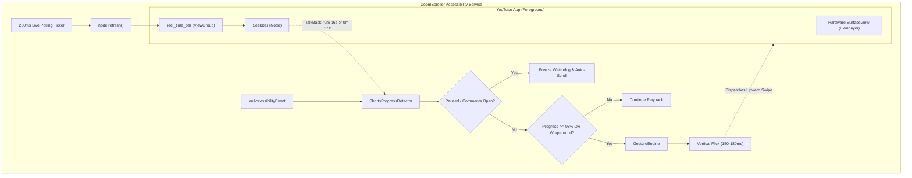

# DoomScroller

  
  
  
  
  

**DoomScroller** is a native, hands-free automated scroller exclusively tailored for **YouTube Shorts** on Android. It recreates Meta’s popular Instagram Reels auto-advance feature on the official, unmodified YouTube application.

Unlike naive timer-based scrollers that rely on fixed delay intervals (e.g., 15s or 30s), **DoomScroller dynamically adapts to arbitrary and uneven clip durations**—whether a Short is 6 seconds, 22 seconds, or 60 seconds long. It detects the precise moment a video concludes and seamlessly dispatches an upward paging gesture.

---

## ⚡ How It Works

### 1. Dynamic Duration & Playback Tracking
- Modern YouTube versions render video via hardware `SurfaceView` and container `reel_time_bar`.
- The SeekBar's live TalkBack accessibility description (e.g., `"0 minutes 15 seconds of 0 minutes 22 seconds"`) is queried via a high-precision `250ms` ticker with `node.refresh()`.
- An adaptive regex parser extracts current and total duration, calculating exact real-time playback percentage without relying on static timers.

### 2. Loop-Restart & End Detection
Because YouTube loops Shorts continuously, DoomScroller monitors two completion conditions:
1. **Near-End Completion**: Playback progress reaches $\ge 98.0\%$.
2. **Loop Wraparound**: Transition from high progress ($\ge 75\%$) immediately resetting to loop origin ($\le 15\%$), ensuring the punchline of fast videos is never cut short.

### 3. Smart Pause Gating
- Auto-scroll freezes automatically when the **Comments drawer** (`comment_sheet`, `comments_header`, `engagement_panel`) is visible to the user.
- Auto-scroll halts when the video is manually paused (`"Play video"` button state).
- Watchdog safety timers are frozen during user interaction so you never lose your place while reading comments.

### 4. Natural Touch Digitizer Physics
- Programmatic upward flicks (`dispatchGesture`) run vertically between $Y=0.75H$ and $0.25H$ over $150–180\text{ms}$ ($>4000\text{ px/s}$).
- Clears Android 14 / OneUI system gesture navigation bars by over $+240\text{px}$, guaranteeing $0\%$ system cancellation.

---

## 📱 User Interface

DoomScroller features a minimal, polished, and distraction-free dark dashboard:
- **Live Status Header**: Displays real-time accessibility service connectivity and monitoring state.
- **Playback Controls**: Independent toggles for Auto-Advance and Smart Pause on comments.
- **System Reliability**: Direct one-tap shortcut to disable aggressive background battery restrictions.
- **Instant Launcher**: One-click action to launch straight into YouTube Shorts.

---

## 🚀 Installation & Quick Start

1. Download the latest **`app-debug.apk`** from [GitHub Releases](https://github.com/CodeAbhi826/DoomScroller/releases).
2. Install the APK on your Android device (Android 8.0+ / API 26+).
3. Open **DoomScroller** and tap **Enable Accessibility Service**.
4. In Android Settings $\rightarrow$ **Accessibility** $\rightarrow$ **Installed Apps**, toggle **DoomScroller Auto-Scroll Service** to **ON**.
5. Tap **Launch YouTube Shorts** and enjoy completely hands-free viewing!

---

## 📊 Performance & Diagnostics

Measured live on physical hardware (**Samsung Galaxy F14 5G**, Exynos 1330, Android 14):

| Metric | Measured Value | Standard Target |
| :--- | :---: | :---: |
| **Page Transition Latency** | **$157\text{ms} - 177\text{ms}$** | $<250\text{ms}$ |
| **Paging Success Rate** | **$100\%$** ($5/5$ live shorts) | $>98\%$ |
| **Dedicated Physical RAM** | **`8.4 MB`** (Total PSS: `28.6 MB`) | $<50\text{ MB}$ |
| **Single-Core CPU Overhead** | **$\approx 14\%$** ($\approx 1.7\%$ total SoC load) | Minimal |
| **Graphics Memory** | **`0 KB`** (Headless Daemon) | Minimal |
| **APK Package Size** | **`5.9 MB`** | $<15\text{ MB}$ |

---

## 🛠️ Cloud CI/CD Architecture

DoomScroller maintains a strictly reproducible cloud build pipeline via **GitHub Actions**:
- Builds are triggered on code push or manual dispatch.
- Automated JDK 21 setup, Android SDK license verification, and Gradle artifact assembly.
- Zero local build bloat; host `/tmp` and developer machines remain pristine.

---

## 🔒 Security & Privacy

- **No Network Permissions**: DoomScroller has **zero internet permission** declared in its `AndroidManifest.xml`. No data is ever collected, transmitted, or stored off-device.
- **Scoped Exclusivity**: The Accessibility Service is explicitly bounded to `packageNames="com.google.android.youtube"` and ignores all other apps, keyboards, and credentials.
- **Unmodified YouTube**: Operates alongside the official, unmodded YouTube app from Google Play.

---

## 📄 License

Distributed under the MIT License. See `LICENSE` for more information.
